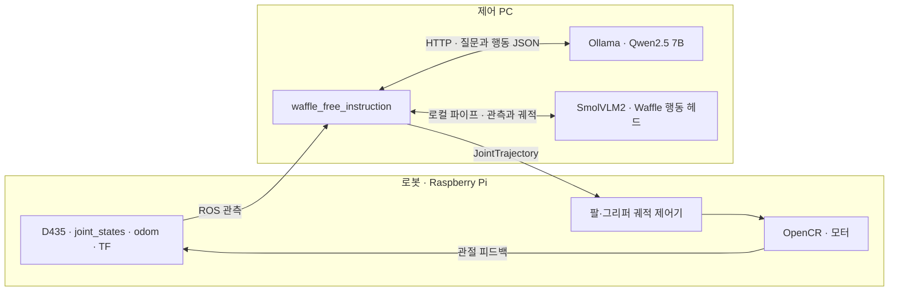

# ROS 2에서 VLM과 VLA를 연결하는 구조

[통합 교안의 아키텍처 배치도](https://docs.google.com/presentation/d/1FeQRLIcLisJhND0R2zncbqJo7Z8gOo95KewRqR4kKms/edit#slide=id.waffle_architecture_map)

## 한국어 지시가 ROS 관절 명령이 되는 경로

하드웨어 백엔드 예시 · “파란 큐브를 초록 칸에 옮겨 줘.”

- **입력** 제어 PC의 free_command.py가 터미널 문장을 읽어 hardware 백엔드에 전달합니다. [구현 또는 기록](https://github.com/SpartaPA/waffle-mpx-lyrical/blob/d50ddf785996099269cc4f46acda7e8dc6edc59b/lessons/13-react/free_command.py#L18-L44)
- **계획** ROS 노드가 관측·이력·지시를 Qwen2.5 7B에 보내 다음 행동과 인자를 받습니다. [구현 또는 기록](https://github.com/SpartaPA/waffle-mpx-lyrical/blob/d50ddf785996099269cc4f46acda7e8dc6edc59b/lessons/13-react/hardware_command.py#L391-L426)
- **정책** place와 blue가 선택되면 영어 하위 지시와 RGB·상태를 VLA 작업 프로세스에 보냅니다. [구현 또는 기록](https://github.com/SpartaPA/waffle-mpx-lyrical/blob/d50ddf785996099269cc4f46acda7e8dc6edc59b/lessons/13-react/hardware_command.py#L356-L376)
- **제어** ROS 노드가 관절 목표를 발행하고 다시 관측합니다. 실행 결과가 다음 턴의 입력이 됩니다. [구현 또는 기록](https://github.com/SpartaPA/waffle-mpx-lyrical/blob/d50ddf785996099269cc4f46acda7e8dc6edc59b/lessons/13-react/hardware_command.py#L375-L426)

통신 경계 · 계획 모델은 Ollama HTTP, 행동 모델은 로컬 파이프, 센서와 제어기는 ROS 2 토픽을 사용합니다. [근거](https://github.com/SpartaPA/waffle-mpx-lyrical/blob/d50ddf785996099269cc4f46acda7e8dc6edc59b/sim/instruction_loop.py#L43-L74)

## 센서 네 개로 한 번의 관측을 구성합니다

실기체 경로 · D435와 로봇 상태가 waffle_free_instruction 노드에서 만납니다.

- **구독** 컬러·정렬 깊이 영상, joint_states, odom을 받습니다. CameraInfo는 따로 보관합니다. [구현 또는 기록](https://github.com/SpartaPA/waffle-mpx-lyrical/blob/d50ddf785996099269cc4f46acda7e8dc6edc59b/lessons/13-react/hardware_command.py#L74-L100)
- **시간 정렬** 시각이 가까운 네 메시지를 묶습니다. 큐 길이는 15, 허용 시간차는 0.1초입니다. [구현 또는 기록](https://github.com/SpartaPA/waffle-mpx-lyrical/blob/d50ddf785996099269cc4f46acda7e8dc6edc59b/lessons/13-react/hardware_command.py#L88-L101)
- **좌표 변환** RGB 시각의 TF를 조회해 광학 좌표의 색상 표면점을 base_footprint로 옮깁니다. [구현 또는 기록](https://github.com/SpartaPA/waffle-mpx-lyrical/blob/d50ddf785996099269cc4f46acda7e8dc6edc59b/lessons/13-react/hardware_command.py#L145-L168)
- **두 입력** 계획기는 물체·목표 좌표와 로봇 상태를 읽습니다. 행동 모델에는 RGB·지시·상태를 전달합니다. [구현 또는 기록](https://github.com/SpartaPA/waffle-mpx-lyrical/blob/d50ddf785996099269cc4f46acda7e8dc6edc59b/lessons/13-react/hardware_command.py#L260-L301)

RGB-D의 깊이는 대상 위치 추정과 운반 결과 확인에 쓰입니다. SmolVLM2의 영상 입력에는 RGB를 넣습니다. [근거](https://github.com/SpartaPA/waffle-mpx-lyrical/blob/d50ddf785996099269cc4f46acda7e8dc6edc59b/lessons/13-react/hardware_command.py#L356-L388)

## SmolVLM2가 Waffle의 VLA에 붙는 위치

색상 운반 경로 · place_blue가 선택된 뒤 모델 안에서 일어나는 계산입니다.

- **인코더** RGB와 영어 지시를 SmolVLM2에 입력해 마지막 토큰의 은닉 벡터를 꺼냅니다. [구현 또는 기록](https://github.com/SpartaPA/waffle-mpx-lyrical/blob/d50ddf785996099269cc4f46acda7e8dc6edc59b/learning/policy.py#L18-L41)
- **상태 결합** 차체 속도 2개와 관절 위치 5개를 정규화해 결합한 뒤 부모 행동 헤드의 은닉층을 거칩니다. [구현 또는 기록](https://github.com/SpartaPA/waffle-mpx-lyrical/blob/d50ddf785996099269cc4f46acda7e8dc6edc59b/learning/color_imitation.py#L28-L44)
- **색상 특징** 선택한 색 영역의 영상 높이와 좌우 위치에서 기하 특징 두 개를 계산합니다. [구현 또는 기록](https://github.com/SpartaPA/waffle-mpx-lyrical/blob/d50ddf785996099269cc4f46acda7e8dc6edc59b/learning/color_imitation.py#L11-L26)
- **행동 헤드** 기하 특징과 부모 특징을 결합해 회귀 헤드가 92시점 × 7축의 목표 배열을 출력합니다. [구현 또는 기록](https://github.com/SpartaPA/waffle-mpx-lyrical/blob/d50ddf785996099269cc4f46acda7e8dc6edc59b/learning/color_imitation.py#L46-L58)

색상 운반은 시작 관측으로 92개를 한 번 예측합니다. 일반 vla 행동은 새 관측을 받아 단일 행동을 8번 추론합니다. [근거](https://github.com/SpartaPA/waffle-mpx-lyrical/blob/d50ddf785996099269cc4f46acda7e8dc6edc59b/lessons/13-react/hardware_command.py#L348-L365)

## ROS 명령이 OpenCR에 도달하는 과정

하드웨어 백엔드의 색상 운반 · 차체는 정지하고 팔 네 축과 그리퍼를 제어합니다.

- **관절 목표** 각 행의 뒤 5개 값을 꺼냅니다. 현재 관절각과의 차이를 0.25초당 허용량으로 제한합니다. [구현 또는 기록](https://github.com/SpartaPA/waffle-mpx-lyrical/blob/d50ddf785996099269cc4f46acda7e8dc6edc59b/lessons/13-react/hardware_command.py#L226-L243)
- **토픽 발행** 팔 4축과 그리퍼 1축을 각각 JointTrajectory로 묶어 두 제어기에 보냅니다. [구현 또는 기록](https://github.com/SpartaPA/waffle-mpx-lyrical/blob/d50ddf785996099269cc4f46acda7e8dc6edc59b/lessons/13-react/hardware_command.py#L100-L107)
- **장치 쓰기** ros2_control의 하드웨어 플러그인이 write()에서 OpenCR에 바퀴·팔·그리퍼 값을 씁니다. [구현 또는 기록](https://github.com/SpartaPA/waffle-mpx-lyrical/blob/d50ddf785996099269cc4f46acda7e8dc6edc59b/turtlebot3_manipulation_hardware/src/turtlebot3_manipulation_system.cpp#L290-L314)
- **피드백** read()가 장치 상태를 갱신합니다. ROS 노드는 joint_states와 새 RGB-D로 움직임을 확인합니다. [구현 또는 기록](https://github.com/SpartaPA/waffle-mpx-lyrical/blob/d50ddf785996099269cc4f46acda7e8dc6edc59b/turtlebot3_manipulation_hardware/src/turtlebot3_manipulation_system.cpp#L244-L284)

토픽 이름은 arm_controller/joint_trajectory와 gripper_controller/joint_trajectory입니다. 14강 Action 클라이언트는 별도 진입점입니다. [근거](https://github.com/SpartaPA/waffle-mpx-lyrical/blob/d50ddf785996099269cc4f46acda7e8dc6edc59b/lessons/13-react/hardware_command.py#L100-L107)

## 같은 운반 지시를 두 백엔드에서 실행합니다

자유 지시의 place 행동 · 어느 부분이 같고, 어느 인터페이스가 달라질까요?

- **Isaac 관측** 가상 D435 영상과 시뮬레이터의 관절·블록 자세를 읽습니다. 순차 계획이나 턴별 계획을 사용합니다. [구현 또는 기록](https://github.com/SpartaPA/waffle-mpx-lyrical/blob/d50ddf785996099269cc4f46acda7e8dc6edc59b/sim/instruction_loop.py#L183-L240)
- **Isaac 제어** 정책 출력을 Isaac 관절 목표 API에 적용합니다. 물리 엔진이 갱신한 블록 위치로 안착을 확인합니다. [구현 또는 기록](https://github.com/SpartaPA/waffle-mpx-lyrical/blob/d50ddf785996099269cc4f46acda7e8dc6edc59b/sim/instruction_loop.py#L302-L345)
- **ROS 관측** 실기체 경로는 D435와 TF로 표면점을 추정합니다. Qwen은 매 턴 새 관측과 이력을 읽습니다. [구현 또는 기록](https://github.com/SpartaPA/waffle-mpx-lyrical/blob/d50ddf785996099269cc4f46acda7e8dc6edc59b/lessons/13-react/hardware_command.py#L391-L426)
- **ROS 제어** ROS 궤적 토픽으로 목표를 보내고 다시 촬영합니다. 표면점의 수평·높이 오차로 결과를 확인합니다. [구현 또는 기록](https://github.com/SpartaPA/waffle-mpx-lyrical/blob/d50ddf785996099269cc4f46acda7e8dc6edc59b/lessons/13-react/hardware_command.py#L364-L388)

이 Isaac 자유 지시 예제는 관절을 직접 제어합니다. ROS 브리지 연결 여부와 별개로 이 실행의 동작은 Isaac API에서 일어납니다. [근거](https://github.com/SpartaPA/waffle-mpx-lyrical/blob/d50ddf785996099269cc4f46acda7e8dc6edc59b/sim/instruction_loop.py#L204-L225)

## 정책만 ROS에 연결해 출력을 관찰하는 경로

learning/ros_policy.py · 자연어 플래너를 거치지 않고 Policy.predict()를 호출하는 별도 노드입니다.

- **동기화** waffle_learning이 RGB·joint_states·odom을 묶습니다. 기본 처리 주기는 최대 5 Hz입니다. [구현 또는 기록](https://github.com/SpartaPA/waffle-mpx-lyrical/blob/d50ddf785996099269cc4f46acda7e8dc6edc59b/learning/ros_policy.py#L26-L32)
- **추론** 동기화한 RGB·7축 상태와 --instruction을 정책에 전달해 7개 행동값을 예측합니다. [구현 또는 기록](https://github.com/SpartaPA/waffle-mpx-lyrical/blob/d50ddf785996099269cc4f46acda7e8dc6edc59b/learning/ros_policy.py#L71-L94)
- **예측 관찰** 기본 정책 모드에서는 learning/predicted_action으로 후보를 발행합니다. [구현 또는 기록](https://github.com/SpartaPA/waffle-mpx-lyrical/blob/d50ddf785996099269cc4f46acda7e8dc6edc59b/learning/ros_policy.py#L65-L98)
- **실행 분기** --execute에서 시간·범위를 검사합니다. 통과하면 cmd_vel과 팔·그리퍼 토픽에 명령을 보냅니다. [구현 또는 기록](https://github.com/SpartaPA/waffle-mpx-lyrical/blob/d50ddf785996099269cc4f46acda7e8dc6edc59b/learning/ros_policy.py#L98-L115)

추론 지연이 0.45초를 넘거나 관측 시각이 허용 범위를 벗어나면 차체 정지 명령을 보내고 그 샘플의 팔 목표 발행을 건너뜁니다. [근거](https://github.com/SpartaPA/waffle-mpx-lyrical/blob/d50ddf785996099269cc4f46acda7e8dc6edc59b/learning/ros_policy.py#L95-L115)

## 어디까지 검증했는지 로그로 판별합니다

같은 “운반 완료”라도 모델 응답, 제어기 피드백, 물체의 실제 위치가 답하는 질문은 다릅니다.

- **모델** Isaac budget6에서 계획 모델 호출 1회, VLA 추론 1회가 기록됐습니다. [구현 또는 기록](https://github.com/SpartaPA/waffle-mpx-lyrical/blob/d50ddf785996099269cc4f46acda7e8dc6edc59b/lessons/14-18/records/missions/budget6/outcome.json)
- **물리 시뮬** 촬영 → 파란 블록 운반 → 촬영을 확인했습니다. 독립 채점의 최종 목표 오차는 4.9 mm입니다. [구현 또는 기록](https://github.com/SpartaPA/waffle-mpx-lyrical/blob/d50ddf785996099269cc4f46acda7e8dc6edc59b/lessons/14-18/records/missions/budget6/score.json)
- **ROS 모의** 모의 제어기에서 팔 0.18 rad 목표에 0.175 rad 피드백을 받았습니다. 고정 RGB-D 운반 시험은 위치 검사에서 실패했습니다. [구현 또는 기록](https://github.com/SpartaPA/waffle-mpx-lyrical/blob/d50ddf785996099269cc4f46acda7e8dc6edc59b/lessons/13-react/free-instruction.md#L107-L110)
- **실기체** OpenCR 쓰기·피드백 코드는 연결돼 있습니다. 실제 물체를 잡아 놓는 성능은 실기체에서 별도로 측정해야 합니다. [구현 또는 기록](https://github.com/SpartaPA/waffle-mpx-lyrical/blob/d50ddf785996099269cc4f46acda7e8dc6edc59b/turtlebot3_manipulation_hardware/src/turtlebot3_manipulation_system.cpp#L244-L314)

고정 영상 시험에서는 블록과 목표의 수평 오차가 46.6 mm였습니다. 제어기 수신과 운반 성공을 각각 확인하는 사례입니다. [근거](https://github.com/SpartaPA/waffle-mpx-lyrical/blob/d50ddf785996099269cc4f46acda7e8dc6edc59b/lessons/13-react/free-instruction.md#L107-L110)

