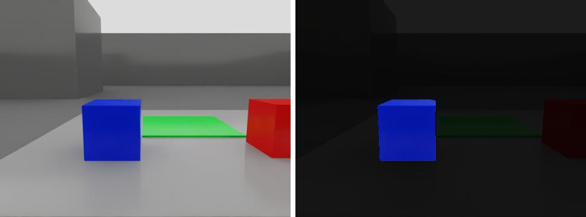
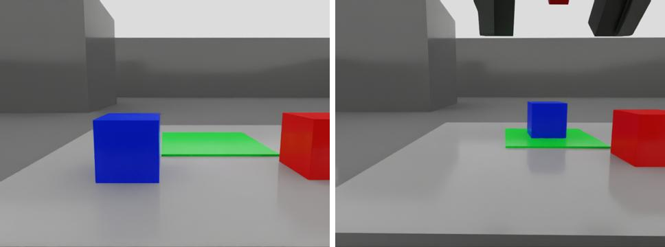

# 강의별 코드 읽기와 연구 자료

## 14강 · 명령 계약과 ROS 2 Action

### Action의 세 메시지는 언제 오갈까요?

팔을 3초 동안 움직일 때 클라이언트와 제어기가 주고받는 순서입니다.

**요청** joint1~4와 목표각을 보냅니다. → **수락** goal handle을 받아 결과를 기다립니다. → **피드백** 제어기가 보고한 현재 각도를 모읍니다. → **종료** 상태와 error_code를 읽습니다.

취소 실험에서는 수락 뒤 cancel_goal_async()를 호출하고 같은 결과 future의 최종 상태를 확인합니다.

[원문과 코드 위치](https://github.com/SpartaPA/waffle-mpx-lyrical/blob/77c04d2fa6ab2e1c96a626c77c01dcc4166bab7a/lessons/14-18/action_client.py#L45-L65)

### 전송 전 검사는 어떤 오류를 잡을까요?

lab.py의 contract()는 좌표 기반 상위 요청을 검사합니다.

```python
if not 0 <= goal["age_s"] <= .4:
    raise Reject("contract.stale")
```

**0.4초 경계** age_s가 0.4이면 통과하고 0.401이면 거부합니다. 이 함수에서 시각의 경과량은 호출자가 계산해 전달합니다.

[원문과 코드 위치](https://github.com/SpartaPA/waffle-mpx-lyrical/blob/77c04d2fa6ab2e1c96a626c77c01dcc4166bab7a/lessons/14-18/lab.py#L23-L31)

### 취소 수락 뒤 결과를 한 번 더 읽는 이유

action_client.py에서 모의 제어기의 관절 상태로 시작각을 채웁니다.

```python
done = handle.get_result_async()
# 취소 실험에서 실행합니다.
response = wait(node,
    handle.cancel_goal_async(), 3)
result = wait(node, done, 10)
```

**실측 기록 읽기** 취소 기록의 목표는 −0.12 rad, 마지막 관측은 +0.0416 rad입니다. status=5와 목표 도달은 서로 다른 질문에 답합니다.

[원문과 코드 위치](https://github.com/SpartaPA/waffle-mpx-lyrical/blob/77c04d2fa6ab2e1c96a626c77c01dcc4166bab7a/lessons/14-18/action_client.py#L17-L65)

### 관절각에서 오차와 상태를 판독합니다

정상 실행과 취소 실행의 JSON을 나란히 읽습니다.

**정상 실행** 목표 0.1200 rad에서 마지막 관측 0.1192 rad를 빼면 오차는 약 0.0008 rad입니다. status=4와 피드백 59개를 함께 확인합니다.

**취소 실행** 목표에 닿기 전에 취소했습니다. status=5이며 error_code=0입니다. 이 예에서 두 필드 중 취소를 알려 주는 값은 status입니다.

[ROSCon 2026 · ros-controls 발표 자료에서 제어기 계층을 살펴봅니다.](https://control.ros.org/master/_downloads/feb3aee68fd0bbaa05a1ddc700375170/ROSCon2026-talk_ros-controls-project-update.pdf)

## 15강 · RGB-D 관측과 좌표 복원

### 한 픽셀이 월드 좌표가 되는 과정

ground()는 선택한 색의 유효 픽셀마다 다음 계산을 적용합니다.

**RGB** 색상 축과 픽셀의 코사인 유사도를 구합니다. → **깊이** 양수이며 유한한 광축 깊이를 남깁니다. → **역투영** 초점거리와 주점으로 광학 좌표를 얻습니다. → **변환** 외부 보정 행렬을 곱하고 중앙값을 냅니다.

깊이와 RGB가 서로 다른 픽셀을 가리키면 수식이 맞아도 엉뚱한 표면을 복원합니다.

[원문과 코드 위치](https://github.com/SpartaPA/waffle-mpx-lyrical/blob/77c04d2fa6ab2e1c96a626c77c01dcc4166bab7a/lessons/14-18/lab.py#L34-L50)

### 같은 프레임에서 파란 블록만 남깁니다

왼쪽은 Isaac D435 원본, 오른쪽은 ground()와 같은 조건으로 선택한 픽셀입니다.



cosine > 0.92, 파랑 채널 > 45, 깊이 > 0을 함께 적용합니다. 가려진 뒷면은 이 마스크에 포함되지 않습니다.

[원문과 코드 위치](https://github.com/SpartaPA/waffle-mpx-lyrical/blob/77c04d2fa6ab2e1c96a626c77c01dcc4166bab7a/lessons/14-18/lab.py#L34-L50)

### 표면점과 블록 중심은 왜 다를까요?

픽셀을 역투영한 뒤 각 점에 optical_to_world를 적용합니다.

```python
X = (u - cx) * Z / fx
Y = (v - cy) * Z / fy
p = [X, Y, Z, 1]
world = optical_to_world @ p
```

**좌표 대조** 복원한 X는 약 0.199 m, 물리 엔진의 블록 중심 X는 약 0.209 m입니다. 보이는 표면의 중앙값을 파지 중심으로 쓰면 약 10 mm가 어긋납니다.

[원문과 코드 위치](https://github.com/SpartaPA/waffle-mpx-lyrical/blob/77c04d2fa6ab2e1c96a626c77c01dcc4166bab7a/lessons/14-18/lab.py#L41-L50)

### 스테레오 깊이는 어떻게 만들어질까요?

NVIDIA Research · FoundationStereo, CVPR 2025

[NVIDIA 공식 시연](https://youtu.be/R7RgHxEXB3o)

저자의 시연에서 재질과 경계에 따라 복원 품질이 달라지는 지점을 찾습니다. 실습의 ground()는 이미 생성된 깊이를 입력받습니다.

[논문 그림 · Overview와 D435 비교 열기](https://nvlabs.github.io/FoundationStereo/)

## 16강 · VLA 궤적과 물리 제어

### 학습된 정책에서 관절 목표까지

색상 운반 정책은 첫 관측에서 전체 궤적을 한 번 예측합니다.

**입력** 시작 RGB, 영어 하위 지시, 로봇 상태를 읽습니다. → **특징 결합** 부모 VLA 은닉값과 색상 기하 특징을 합칩니다. → **회귀 헤드** 가중치를 곱해 92×7 궤적을 얻습니다. → **물리 적용** 현재 관절과의 차이를 제한해 적용합니다.

조작 도중 블록을 밀면 미리 예측한 나머지 궤적이 어긋날 수 있습니다. 어느 시점에서 재관측할지 토론합니다.

[원문과 코드 위치](https://github.com/SpartaPA/waffle-mpx-lyrical/blob/77c04d2fa6ab2e1c96a626c77c01dcc4166bab7a/learning/color_imitation.py#L28-L58)

### 한 번의 추론이 92개 행동이 되는 코드

ColorPolicy.plan()에서 i는 입력 특징, t는 시점, j는 행동 축입니다.

```python
np.einsum('i,itj->tj',
          design, self.weights)

# 시뮬레이터가 매 시점 선택합니다.
action = trajectory[step]
```

**축을 추적합니다** 출력 한 행의 앞 두 축은 정지한 차체입니다. 뒤의 네 값은 팔의 절대각(rad), 마지막 값은 그리퍼 위치(m)입니다.

[원문과 코드 위치](https://github.com/SpartaPA/waffle-mpx-lyrical/blob/77c04d2fa6ab2e1c96a626c77c01dcc4166bab7a/learning/color_imitation.py#L46-L58)

### 파란 블록을 실제로 옮겼는지 확인합니다

왼쪽은 시작 관측, 오른쪽은 같은 시드의 파란 블록 운반 종료 장면입니다.



파란 블록 기록에서 최대 상승은 약 59 mm입니다. 초록 칸 내부, 블록 속도, 그리퍼와의 거리 조건이 연속으로 충족돼야 안착 시간이 쌓입니다.

[원문과 코드 위치](https://github.com/SpartaPA/waffle-mpx-lyrical/blob/77c04d2fa6ab2e1c96a626c77c01dcc4166bab7a/sim/evaluate_pick_place.py#L241-L263)

### SlotVLA는 물체 간 관계를 어떻게 표현할까요?

ICRA 2026 · 연구팀의 구조도와 공식 영상에서 슬롯의 역할을 찾습니다.

**모델의 질문** 집게, 그릇, 받침을 각각 추적하면 행동을 정할 때 어떤 관계를 보존할 수 있을까요? 연구팀은 물체 슬롯과 관계 토큰으로 행동을 예측합니다.

**영상 읽기** 00:38 방법, 00:57 시뮬레이션, 01:48 실기체를 봅니다. Waffle의 두 가지 색상 기하 특징으로 표현하기 어려운 관계를 하나 적습니다.

[연구팀 공식 영상·구조도·논문 열기](https://slot-vla.github.io/)

## 17강 · 버전별 검색과 인용 검증

### 언제 LLM을 호출하고 언제 멈출까요?

질문은 같아도 매뉴얼 버전에 따라 답변의 근거가 바뀝니다.

**버전 필터** 요청 버전의 문서 조각만 남깁니다. → **검색** 질문과 겹치는 단어 수로 최대 2개를 뽑습니다. → **생성** Qwen2.5 7B가 ID와 인용문을 반환합니다. → **대조** 같은 ID의 원문에 인용문이 있는지 봅니다.

검색 결과가 없으면 no_evidence로 끝납니다. 검색된 근거와 생성 문장이 맞지 않으면 unsupported입니다.

[원문과 코드 위치](https://github.com/SpartaPA/waffle-mpx-lyrical/blob/77c04d2fa6ab2e1c96a626c77c01dcc4166bab7a/lessons/14-18/lab.py#L62-L82)

### 키워드 검색이 놓치는 질문을 만듭니다

retrieve()는 버전을 먼저 거른 뒤 서로 다른 단어의 교집합 크기를 셉니다.

```python
if doc["version"] != version: continue
score = len(words.intersection(doc["terms"]))
if score: ranks.append((score, doc))
```

**표현을 바꿉니다** 원문 질문의 ‘블록 운반 후 안착 조건은’과 동의어만 쓴 ‘이송 완료 기준?’을 비교합니다. 같은 뜻이라도 공유 토큰이 없으면 근거가 비게 됩니다.

[원문과 코드 위치](https://github.com/SpartaPA/waffle-mpx-lyrical/blob/77c04d2fa6ab2e1c96a626c77c01dcc4166bab7a/lessons/14-18/lab.py#L62-L81)

### 인용이 맞아도 현재 상태는 따로 확인합니다

매뉴얼의 규칙과 센서의 측정값은 역할이 다릅니다.

**매뉴얼이 답하는 질문** 버전 2의 table-v2-settle은 목표 칸에서 약 0.5초 이상 안정된 상태를 확인하도록 합니다. 인용 검사는 반환된 구절이 해당 문서에 있는지 확인합니다.

**실행 기록이 답하는 질문** 지금 블록이 실제로 안착했는지는 stable_s와 wrong_pick으로 확인합니다. 다른 문장의 일부를 인용해도 문자열 대조를 통과할 수 있습니다.

[실제 Qwen 응답과 인용한 ID 열기](https://github.com/SpartaPA/waffle-mpx-lyrical/blob/77c04d2fa6ab2e1c96a626c77c01dcc4166bab7a/lessons/14-18/records/lesson-17.json)

### 최근 연구는 매뉴얼을 행동에 어떻게 연결할까요?

Embodied RAG++ · 2026년 11월 5일 공개한 연구 프리프린트입니다.

**연구 질문** 장면에 보이는 대상에 맞는 매뉴얼을 찾은 뒤, 현재 로봇 위치와 물체 상태에서 그 기능을 실제로 쓸 수 있는지 판단합니다.

**수업 코드와 연결** 우리 검색기는 버전과 단어만 봅니다. 같은 설명서를 쓰는 두 기기 중 하나가 손이 닿지 않는 곳에 있다면 어떤 상태 필드를 더 읽어야 할까요?

[Embodied RAG++ 원문과 저자 정보 열기](https://arxiv.org/abs/2611.07517)

## 18강 · 통합 평가와 실패 진단

### 한 사례의 최초 실패는 어디서 결정될까요?

run_case()는 첫 Reject에서 멈추고 benchmark()가 종료 사유를 채점합니다.

**지시·계획** 색상 수와 그래프의 순환 여부를 봅니다. → **근거·좌표** 매뉴얼을 찾고 RGB-D 점과 계약을 검사합니다. → **실행 기록** 도구 오류, 시간 초과, 관절값을 검사합니다. → **채점** 관측한 종료 사유를 expected와 비교합니다.

위상 정렬은 주어진 의존성의 순환을 검출합니다. 이 재생 평가에서 새로운 물리 행동을 실행하지는 않습니다.

[원문과 코드 위치](https://github.com/SpartaPA/waffle-mpx-lyrical/blob/77c04d2fa6ab2e1c96a626c77c01dcc4166bab7a/lessons/14-18/lab.py#L85-L130)

### 같은 지시를 두 경로로 채점합니다

01-파란은 정상 지시와 같은 문장에 age=1.2초를 지정합니다.

```python
if guarded: contract(goal)
# 계약이 거부하면 benchmark가 기록합니다.
except Reject as exc:
    observed = str(exc)
```

**기대값의 역할** 이 사례의 expected는 contract.stale입니다. 검증 경로가 오래된 관측을 거부하면 정답 1건입니다. 물체를 집었다는 뜻의 점수와 구분합니다.

[원문과 코드 위치](https://github.com/SpartaPA/waffle-mpx-lyrical/blob/77c04d2fa6ab2e1c96a626c77c01dcc4166bab7a/lessons/14-18/lab.py#L96-L129)

### 12건의 차이는 무엇을 뜻할까요?

기준선 8/20과 검증 경로 20/20은 같은 저장 기록과 기대 종료 사유를 사용합니다.

**직접 계산** 8÷20=40%, 20÷20=100%입니다. 차이는 60%p입니다. 새로 올바른 거부가 생겼는지는 각 사례의 observed와 expected를 대조합니다.

**다음 물리 시험** 같은 지시와 같은 시드를 두 제어기에 한 쌍씩 배정합니다. 목표 오차, 다른 물체의 상승, 촬영 순서를 따로 채점하고 분모를 실제 실행 횟수로 씁니다.

[사례별 기준선·검증 결과 열기](https://github.com/SpartaPA/waffle-mpx-lyrical/blob/77c04d2fa6ab2e1c96a626c77c01dcc4166bab7a/lessons/14-18/records/lesson-18.json)

### 배치를 바꿔도 성공한다는 주장을 시험합니다

LIBERO-Plus · CVPR 2026의 평가 설계를 Waffle 과제로 옮깁니다.

**한 번에 바꿀 조건** 연구진은 배치, 카메라, 로봇 시작 상태, 지시 표현, 조명, 배경, 센서 잡음을 나눠 시험합니다. 왼쪽 지시 실험에서는 우선 배치만 반전합니다.

**기록할 결과** 배치 A와 B의 대상 색, 최대 상승, 목표 오차, 최초 실패를 표에 적습니다. 반복 수가 1인 칸은 한 번의 관측으로 표시합니다.

[LIBERO-Plus 논문·평가 설계 그림 열기](https://openaccess.thecvf.com/content/CVPR2026/html/Fei_LIBERO-Plus_A_Progressive_Robustness_Benchmark_for_Visual-Language-Action_Models_CVPR_2026_paper.html)


